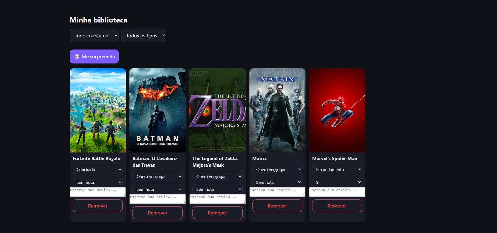
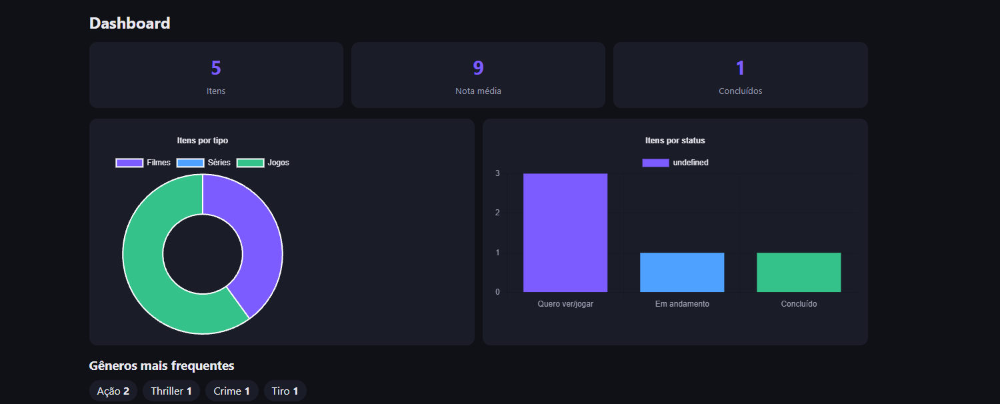

# 🎬 Mídia Hub

Hub pessoal para organizar **filmes, séries e jogos**: busque numa base real, salve numa biblioteca com status, nota e review, e acompanhe suas estatísticas num dashboard.

🔗 **Demo:** LINK_DA_VERCEL: https://midia-hub-client.vercel.app/
> A API roda no plano gratuito do Render e "dorme" quando fica parada. A primeira ação pode levar até ~50 segundos.




## Funcionalidades

- Cadastro e login com JWT (cada usuário vê só a própria biblioteca)
- Busca de filmes e séries (TMDB) e jogos (RAWG)
- Biblioteca com status (quero ver/jogar, em andamento, concluído), nota de 1 a 10 e review
- Filtros por status e tipo, e o botão "me surpreenda"
- Dashboard com totais, nota média, gráficos e gêneros favoritos
- Tema claro e escuro, layout responsivo (mobile-first)

## Stack

| Camada | Tecnologias |
|---|---|
| Front-end | HTML, CSS e JavaScript puro, Chart.js |
| Back-end | Node.js, Express, Zod, JWT, bcryptjs |
| Banco | PostgreSQL (Neon) com Prisma ORM |
| Deploy | Vercel (front), Render (API), Neon (banco) |
| Qualidade | ESLint, Prettier e GitHub Actions |

## Como funciona

```
Navegador (Vercel) → API Express (Render) → PostgreSQL (Neon)
                          ↓
                   TMDB e RAWG (proxy)
```

- As chaves das APIs externas ficam **só no servidor**; o front chama a minha API, que atua como proxy.
- As senhas são salvas com hash (bcrypt) e o login devolve um JWT que vai no header `Authorization`.
- Todas as rotas da biblioteca filtram pelo usuário logado.

## Rodando localmente

Pré-requisitos: Node.js 22+, um banco PostgreSQL (ex.: Neon grátis) e chaves do TMDB e do RAWG.

```bash
git clone https://github.com/SEU_USUARIO/midia-hub.git
cd midia-hub/server
npm install
cp .env.example .env     # preencha as variáveis
npx prisma migrate deploy
npx prisma generate
npm run dev
```

Abra `client/login.html` com o Live Server (extensão do VS Code).

### Variáveis de ambiente (`server/.env`)

| Variável | Descrição |
|---|---|
| `DATABASE_URL` | String de conexão do PostgreSQL |
| `JWT_SECRET` | Segredo para assinar os tokens |
| `TMDB_KEY` | Chave da API do TMDB |
| `RAWG_KEY` | Chave da API do RAWG |
| `FRONTEND_URL` | (produção) Endereço do front liberado no CORS |

## Endpoints

| Método | Rota | Descrição |
|---|---|---|
| POST | `/auth/register` | Cria a conta |
| POST | `/auth/login` | Entra e devolve o token |
| GET | `/search?q=&type=` | Busca (movie, tv ou game) |
| GET/POST | `/library` | Lista e adiciona itens (autenticado) |
| PUT/DELETE | `/library/:id` | Edita e remove um item |
| GET | `/stats` | Estatísticas do dashboard |

## Decisões técnicas

- **Proxy no back-end:** mantém as chaves fora do navegador.
- **Prisma 7:** modelo e migrations versionados no repositório.
- **Zod:** valida toda entrada antes de tocar no banco.
- **CI:** o GitHub Actions roda lint e verificação de formatação em cada PR.

## Autor

Guilherme Henrique Ferreira — [GitHub](https://github.com/Guilherme20252) · [LinkedIn](www.linkedin.com/in/guilherme-henrique-898012325)

## Licença

MIT